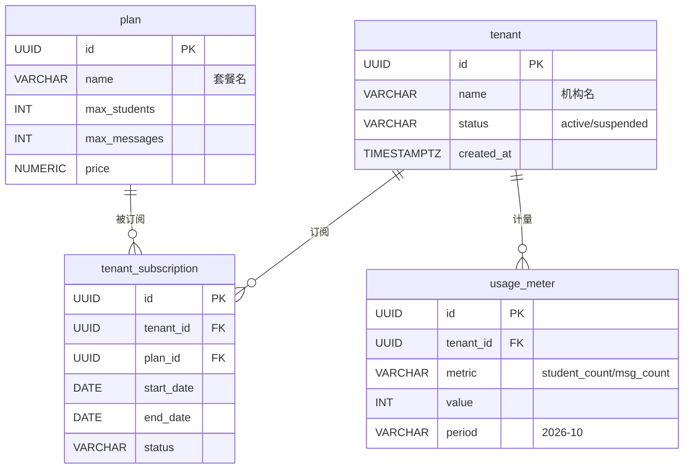
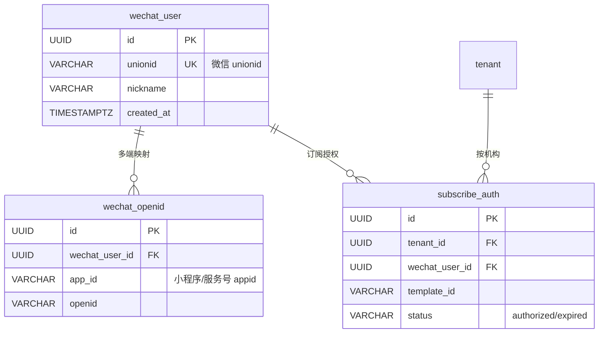

# 0.4 全量 ER 图

> 对应《学生信息管理系统_分步执行清单》步骤 0.4。
> 技术栈：PostgreSQL + SQLAlchemy + Alembic。命名 snake_case、表名单数。
> 配套字段字典：`04-data-dictionary.md`（外键/字段与本文一一对应）。
> 三层共 25 张表：平台层 4、微信层 3、业务层 18（`invite_code` 为 1.6 实现时追加，见 `04-data-dictionary.md` §invite_code）。

## 全局约定（所有图通用）

- 主键统一 `id UUID PK`，默认 `gen_random_uuid()`。
- **业务层每张表必含 `tenant_id UUID NOT NULL FK→tenant.id`**，复合索引一律从 `tenant_id` 起（对应 0.3 决策 1）。
- 平台层不强制 `tenant_id`（`tenant` 表自身除外）；微信层 `subscribe_auth` 带 `tenant_id`。
- 课时流水 `lesson_ledger` 为**只增**设计：无 `updated_at`、无可变余额列，余额 = `SUM(delta)`（红线二）。**一期余额一律实时 SUM(delta) 计算，不引入快照表；快照表留到有性能需要时再引入**（本版已移除 balance_snapshot）。
- 签到 `attendance` 对 `(lesson_id, student_id)` 建唯一约束 = 幂等键（红线三）。
- **单校区模型**：一个租户即一个校区，**不建校区表（campus/branch）**，教室、班级、老师直接挂 `tenant_id`。多校区需求出现时以「租户 + 校区」两级扩展，届时不改现有表结构，只加 `campus_id` 维度。

---

## 一、平台层（platform 侧，4 张）



> 平台层交付：tenant 一期（地基），plan/tenant_subscription/usage_meter 二期（SaaS 运营 US-401/402/404）。

## 二、微信层（3 张）



> `wechat_openid` 唯一约束 `(app_id, openid)`；`subscribe_auth` 为二期消息触达预留（US-006/403）。

## 三、业务层（17 张，每张含 tenant_id）

```mermaid
erDiagram
    tenant ||--o{ student : "拥有"
    tenant ||--o{ parent : "拥有"
    tenant ||--o{ teacher : "拥有"
    tenant ||--o{ classroom : "拥有"
    tenant ||--o{ staff_account : "拥有"
    tenant ||--|| org_config : "配置"

    parent ||--o{ parent_student : "绑定"
    student ||--o{ parent_student : "被绑定"
    wechat_user ||--o{ parent : "微信关联"

    course ||--o{ class : "开成班级"
    teacher ||--o{ class : "任教"
    classroom ||--o{ class : "占用"
    class ||--o{ class_enrollment : "含学员"
    student ||--o{ class_enrollment : "入班"

    course_package ||--o{ purchase : "被购买"
    student ||--o{ purchase : "购课"
    student ||--o{ lesson_ledger : "记账"
    purchase ||--o{ lesson_ledger : "来源"
    lesson ||--o{ lesson_ledger : "消耗对应课次"

    class ||--o{ schedule_rule : "规律排课"
    classroom ||--o{ schedule_rule : "占用"
    teacher ||--o{ schedule_rule : "占用"
    class ||--o{ lesson : "生成课次"
    classroom ||--o{ lesson : "上课地点"
    teacher ||--o{ lesson : "授课"

    lesson ||--o{ attendance : "签到"
    student ||--o{ attendance : "被点名"
    staff_account ||--o{ attendance : "经办"

    student ||--o{ refund : "退费"
    purchase ||--o{ refund : "退费来源"

    student {
        UUID id PK
        UUID tenant_id FK
        VARCHAR name
        VARCHAR grade "年级"
        VARCHAR school "在读学校"
        VARCHAR status "active/suspended/archived"
        VARCHAR contact
    }
    parent {
        UUID id PK
        UUID tenant_id FK
        VARCHAR name
        VARCHAR phone
        UUID wechat_user_id FK "可空"
    }
    teacher {
        UUID id PK
        UUID tenant_id FK
        VARCHAR name
        VARCHAR phone
        VARCHAR subject "可授科目"
        VARCHAR status
    }
    classroom {
        UUID id PK
        UUID tenant_id FK
        VARCHAR name
        INT capacity "容量 US-216"
        JSONB available_slots "可用时段 US-216"
    }
    course {
        UUID id PK
        UUID tenant_id FK
        VARCHAR name
        VARCHAR subject
    }
    class {
        UUID id PK
        UUID tenant_id FK
        UUID course_id FK
        UUID teacher_id FK
        UUID classroom_id FK
        VARCHAR name
        INT capacity
    }
    class_enrollment {
        UUID id PK
        UUID tenant_id FK
        UUID class_id FK
        UUID student_id FK
        DATE joined_at
    }
    course_package {
        UUID id PK
        UUID tenant_id FK
        VARCHAR name
        INT total_lessons
        INT gift_lessons "赠课"
        NUMERIC price
        INT valid_months "有效期 US-205"
    }
    purchase {
        UUID id PK
        UUID tenant_id FK
        UUID student_id FK
        UUID course_id FK "2.3：买的是哪门课"
        UUID package_id FK "课时包快照"
        INT quantity
        NUMERIC amount
        TIMESTAMPTZ purchased_at
        DATE expires_at "由 valid_months 算出"
    }
    lesson_ledger {
        UUID id PK
        UUID tenant_id FK
        UUID student_id FK
        UUID purchase_id FK "consume 必填 其余可空"
        UUID lesson_id FK "consume 必填 其余可空"
        VARCHAR type "purchase/grant/consume/adjust/expire"
        INT delta "正=增 负=减 只增不改"
        VARCHAR reason
        UUID operator_id
        TIMESTAMPTZ created_at
    }
    schedule_rule {
        UUID id PK
        UUID tenant_id FK
        UUID class_id FK
        UUID classroom_id FK
        UUID teacher_id FK
        INT weekday "0-6"
        TIME start_time
        TIME end_time
        DATE start_date
        DATE end_date
    }
    lesson {
        UUID id PK
        UUID tenant_id FK
        UUID class_id FK
        UUID classroom_id FK
        UUID teacher_id FK
        TIMESTAMPTZ start_at
        TIMESTAMPTZ end_at
        VARCHAR status "normal/moved/makeup/cancelled"
    }
    attendance {
        UUID id PK
        UUID tenant_id FK
        UUID lesson_id FK "幂等键之一"
        UUID student_id FK "幂等键之一"
        VARCHAR status "present/leave/absent"
        INT deduct_lessons "本次扣课时"
        UUID operator_id
        TIMESTAMPTZ created_at
    }
    parent_student {
        UUID id PK
        UUID tenant_id FK
        UUID parent_id FK
        UUID student_id FK
        VARCHAR relation "父/母/祖辈"
    }
    staff_account {
        UUID id PK
        UUID tenant_id FK
        VARCHAR name
        VARCHAR phone
        VARCHAR role "admin/registrar/teacher"
        UUID teacher_id FK "老师角色时关联"
        VARCHAR status
    }
    org_config {
        UUID id PK
        UUID tenant_id FK "UNIQUE 一机构一条"
        VARCHAR absence_deduct_rule "none/deduct 请假与缺勤通用 US-217"
        VARCHAR logo
        JSONB notify_template
    }
    refund {
        UUID id PK
        UUID tenant_id FK
        UUID student_id FK
        UUID purchase_id FK
        NUMERIC amount
        VARCHAR status "pending/approved/refunded"
        UUID approver_id
    }
```

---

## 四、多课时包扣减顺序规则（consume 流水依据）

学生同时持有多个有效课时包时，一次签到扣课按以下顺序选择被扣的课时包：

1. **先过期先扣**：按 `purchase.expires_at` **升序**，越早到期的包越先被扣；
2. **同日到期先购先扣**：`expires_at` 相同（含同日）时，按 `purchase.purchased_at` **升序**，先购买的包先扣；
3. 选中包后写入一条 `lesson_ledger` 的 `consume` 流水，`purchase_id` 指向被扣包、`lesson_id` 指向本次课次，`delta` 为负；
4. 该包剩余不足本次扣减时，按上述顺序顺延到下一个有效包（一笔签到可拆成多条 consume 流水，每条仍挂各自的 purchase_id / lesson_id）。

> 此规则同步作为 0.5 API 清单中「签到扣课」接口的选包依据。已过期（expires_at < 当前）或余额为 0 的包不参与扣减；课时包到期后的自动处理规则后置二期（US-205）。

## 红线在表结构上的落点（自检）

| 红线 | 表结构落点 |
|------|------------|
| 红线一：业务表带 tenant_id、复合索引从 tenant_id 起 | 业务层 17 张表全部含 `tenant_id`，字典中复合索引均以 `tenant_id` 前缀 |
| 红线二：余额只能由流水变更 | `lesson_ledger` 只增（无 updated_at、无余额列）；余额 = `SUM(delta)` 实时计算，不引入快照表；consume 流水必须挂 `purchase_id`（扣哪个包）与 `lesson_id`（哪次课） |
| 红线三：签到扣课同事务且幂等 | `attendance` 唯一约束 `(lesson_id, student_id)`，重复签到被唯一键拒绝；扣课与签到在同一事务 |

## 与上游文档对应

- `tenant_id` 全覆盖 + RLS → 0.3 决策 1/2
- `student.status`（active/suspended/archived）→ 0.2 修正口径：删除 = 改状态，不物理删除
- `course_package.valid_months` → 0.1 US-205 有效期
- `org_config.absence_deduct_rule` → 0.1 US-217 请假/缺勤扣课规则（两者通用）
- `classroom.capacity / available_slots` → 0.1 US-216 教室档案
