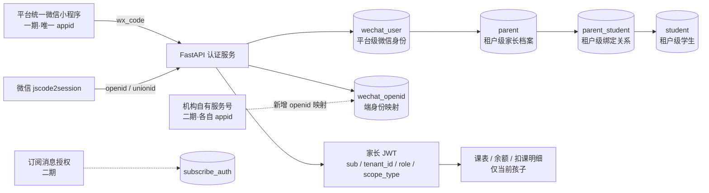
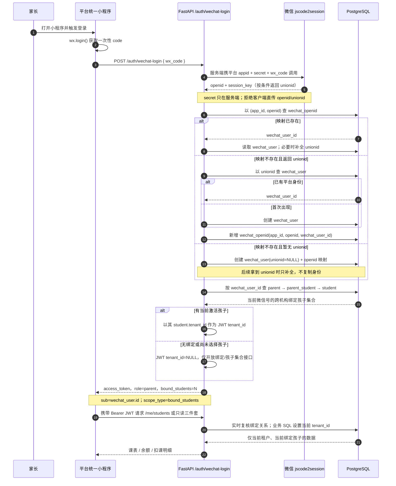
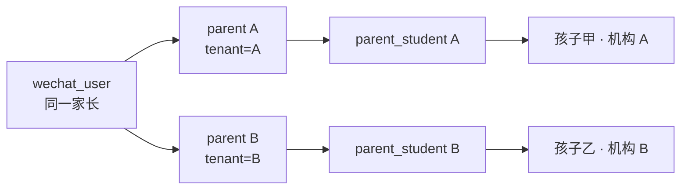
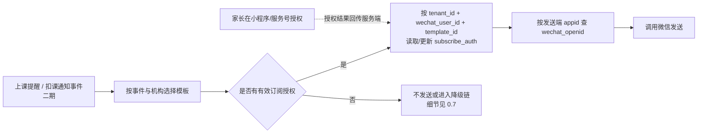

# 0.6 微信端架构（统一小程序 + unionid 打通）

> 对应《学生信息管理系统_分步执行清单》步骤 0.6。
> 一期：平台统一微信小程序，只读三件套 + 邀请码绑定；机构自有服务号、订阅消息推送为二期。
> 上游：0.3 租户隔离、0.4 微信层 3 表、0.5 认证与家长端接口。本文只定身份与跨端架构，不改一期业务边界。

## 1. 总体架构与身份分层



身份分三层，职责不可混用：

1. **微信身份层（平台级）**：`wechat_user` 代表同一个微信自然人；`wechat_openid` 代表此人在某个 appid 下的端身份。
2. **机构身份层（租户级）**：`parent` 是某机构里的家长档案；同一微信用户在不同机构可有不同 `parent.id`。
3. **业务授权层（租户级）**：`parent_student` 决定能看哪个孩子；JWT 只证明登录身份与当前租户上下文，绑定集合仍由服务端实时查库。

**边界原则**：openid/unionid 只用于识别“是谁”，不能单独证明“能看谁”；能否访问学生数据必须由 `parent → parent_student → student` 链路决定，并叠加租户 RLS。

---

## 2. 核心问题一：家长如何被识别

### 2.1 完整登录时序



### 2.2 登录与鉴权的不可省略规则

- **code 只能由服务端兑换**：`appid + secret + wx_code` 不经过小程序；`session_key` 不作为本系统 JWT，也不下发给业务端。
- **先定位端身份，再定位平台身份**：先查 `UK(app_id, openid)`；新端出现时再通过 unionid 归并到既有 `wechat_user`，最后补一条 `wechat_openid`。
- **unionid 暂缺可登录**：0.4 的 `wechat_user.unionid` 允许 NULL，PostgreSQL 唯一索引允许多个 NULL；不能因暂缺 unionid 阻止一期小程序登录。
- **异常不自动合并**：若已保存的 unionid 与微信本次返回值冲突，停止自动归并并记录安全事件；绝不按昵称、头像或手机号相同自动合并账号。
- **JWT 对齐 0.5 第 0 节**：`sub=wechat_user.id`、`role=parent`、`scope_type=bound_students`；`tenant_id` 取**当前激活孩子**所属机构。绑定集合不写死在 token 内，每次请求实时查库。
- **无绑定 token 的最小权限**：`tenant_id=NULL` 时只可调用登录后续所需的 `/me/bindings`、`/me/students`、`/me/active-student`；访问任何业务数据一律 403。
- **切换孩子即切换租户上下文**：`POST /me/active-student` 先校验目标在绑定集合内，再更新服务端激活孩子并**重签 JWT**。旧 token 立即不能用于新业务上下文，防止 A 机构 token 搭配 B 机构学生 ID 越权。
- **业务查询双保险**：服务端以 JWT 的 tenant_id 设置 RLS 上下文，同时校验激活孩子属于该 tenant 且仍与 `sub` 绑定；前端传 tenant_id 一律忽略。

> 家长跨机构的 `/me/students` 是“本人绑定集合”受控查询：只能以 JWT `sub` 对应的 `wechat_user_id` 为入口返回孩子 ID、姓名、所属机构，不返回任何跨机构业务明细。课表、余额、明细仍必须进入单一当前租户并受 RLS 过滤，不能给应用角色开放通用跨租户查询能力。

---

## 3. 核心问题二：跨小程序/服务号如何认同一人

### 3.1 前提：同一个微信开放平台账号

**openid 按 appid 隔离，不能直接跨端比较；unionid 才是同一微信开放平台账号下的跨端标识。**

二期接入前，平台统一小程序与各机构自有服务号必须绑定到**同一个微信开放平台账号**。若某机构服务号属于另一个开放平台账号，其 unionid 体系不同，不能声称可与平台身份自动归并，只能走“已登录小程序后确认绑定”的人工授权流程。

### 3.2 unionid 映射关系

```mermaid
flowchart TB
    OP[同一微信开放平台账号<br/>跨端归并前提]
    OP --> MP[平台统一小程序<br/>appid = mp_platform]
    OP --> OA1[机构 A 服务号<br/>appid = oa_a]
    OP --> OA2[机构 B 服务号<br/>appid = oa_b]

    MP -->|openid = o_mp_123| R1[wechat_openid<br/>(mp_platform, o_mp_123)]
    OA1 -->|openid = o_a_456| R2[wechat_openid<br/>(oa_a, o_a_456)]
    OA2 -->|openid = o_b_789| R3[wechat_openid<br/>(oa_b, o_b_789)]

    R1 -->|相同 unionid = u_001| U[同一 wechat_user<br/>id = wu_001]
    R2 -->|相同 unionid = u_001| U
    R3 -->|相同 unionid = u_001| U
    U --> PA[parent · 机构 A]
    U --> PB[parent · 机构 B]
```

一期小程序登录建立 `wechat_user + (mp_platform, openid)`。二期服务号授权回调取得 `(oa_x, new_openid, same_unionid)` 后：

1. 以 unionid 找到已有 `wechat_user`；
2. 只新增 `wechat_openid(oa_x, new_openid, wechat_user_id)`；
3. 复用原平台身份、家长档案与孩子绑定，**不改 `wechat_user` 主表，不新建第二个微信用户**。

若该微信用户先出现在服务号、后进入小程序，流程对称：按 unionid 找回原身份，仅补小程序 openid 映射行。

---

## 4. 架构决策

### 决策 1：一期采用平台统一 appid，所有租户共用一个小程序

**结论**：只运营平台统一小程序；租户区分靠登录后的当前孩子与 JWT 中的 tenant_id，不靠 appid。

**理由**：

- 一次开发、一次审核、一次发布即可服务全部机构，版本和接口行为一致；
- 只需维护一套 appid/secret、服务器域名、隐私协议与消息模板配置；
- 家长无需为每个机构重复安装/搜索不同小程序，邀请码即可完成机构内绑定。

**弃用“每机构独立小程序”**：每新增机构都要注册主体、审核发布、维护密钥与模板，成本和故障面随机构数线性增长；还会把同一家长拆散到多个小程序入口，运营与跨端身份治理都更复杂。机构自有品牌诉求由二期服务号/机构配置承接，不在一期复制小程序。

### 决策 2：wechat_user 是平台级，不携带 tenant_id

**结论**：`wechat_user` 与 `wechat_openid` 都是平台级表；`parent` 才是租户级身份，通过 `parent.wechat_user_id` 关联。

**理由**：同一微信自然人可能在 A、B 两个机构都有孩子。如果 `wechat_user` 强制带 tenant_id，就会为同一 unionid 建多份“微信自然人”，二期服务号归并与跨机构孩子列表都会被破坏。

**与 0.4 对齐**：

| 表 | 层级与租户口径 | 本架构用途 |
|----|----------------|------------|
| `wechat_user` | 平台级；`unionid` 全局唯一、可空待补 | 微信自然人主身份 |
| `wechat_openid` | 平台级；`UK(app_id, openid)` | 每个小程序/服务号的端身份映射 |
| `parent` | 租户级；`wechat_user_id` 可空 | 某机构内的家长档案，关联平台微信身份 |
| `parent_student` | 租户级；`UK(tenant_id,parent_id,student_id)` | 家长与学生的多对多授权关系 |
| `subscribe_auth` | 微信层但带 tenant_id；二期 | 某机构场景下对某模板的授权状态 |

因此 0.3 的“业务层每表 tenant_id”不被破坏：跨租户共享的只有微信身份，不是业务数据；机构业务表仍全部走 RLS。

### 决策 3：多机构、多家长都通过“平台身份 → 租户档案 → 绑定关系”走数

**一个家长绑多个机构**：



`GET /me/students` 汇聚同一 `wechat_user_id` 下的全部有效绑定；选择孩子后，`POST /me/active-student` 重签带该孩子 tenant_id 的 JWT。之后只读三件套都只作用于当前孩子，不能通过改 student_id 或 tenant_id 越界。

**一个孩子多个家长**：同一 student 通过不同 `parent_student` 行连接父母各自的 parent 档案；父母是两个不同 `wechat_user`。教务分别为其生成邀请码（0.5 允许同一学生同时存在多个有效码），各自绑定后只能看到同一孩子的数据，彼此微信身份不合并。

**绑定事务**：消费邀请码、定位/关联当前 tenant 下的 parent、写 parent_student 必须在同一事务；首次绑定的 tenant_id 由服务端从有效邀请码关联的学生档案解析，绝不接收前端 tenant 参数，绑定成功后重签 JWT。邀请码一次性作废与绑定唯一约束共同防止重复使用。解绑后服务端实时绑定集合立即收窄，旧 token 也不能恢复权限。

### 决策 4：一期邀请码足够，手机号不作强制验证

**结论**：一期家长登录与绑定不强制手机号；教务线下核验后发放的一次性限时邀请码就是机构授权凭证。手机号验证作为二期可选补强，用于异常账号核验或跨开放平台的人工绑定辅助。

**理由**：强制手机号会增加 `getPhoneNumber` 授权、短信/微信能力配置与隐私合规成本，却不能替代机构对孩子关系的授权；邀请码直接表达“机构允许此微信号绑定此学生”，链路更短。

**限制**：不得仅凭手机号一致自动合并 wechat_user，因为手机号会回收、共用或变更；0.4 的 `parent.phone` 继续作为机构内联系方式，不作为跨端身份主键。

### 决策 5：二期只扩展开端映射与授权记录，不推翻一期身份

**结论**：机构服务号接入只新增 `wechat_openid` 行；订阅消息只新增/更新 `subscribe_auth` 与消息任务。`wechat_user`、parent、parent_student 的主关系不变。

**理由**：一期已把“微信自然人”“端 openid”“租户家长”“孩子授权”分层，新增端只是多一种识别入口，不应复制身份或重建绑定。



- 授权入口由对应微信端发起，服务端记录 `tenant_id + wechat_user_id + template_id + status`；客户端不能自行指定他人的 wechat_user_id。
- 模板选择按“事件类型 + 机构配置 + 发送端”确定，发送时再取该端 appid 对应的 openid；不能拿小程序 openid 给服务号发消息。
- 授权次数、发送回执、模板参数和订阅消息→服务号→短信降级链均在 0.7 展开，本图仅固定身份与表关系的占位。

---

## 5. 与 0.5 接口的逐项对应

| 0.5 接口 | 身份架构动作 |
|----------|--------------|
| `POST /auth/wechat-login` | code 换 openid/unionid；定位/创建 wechat_user 与 openid 映射；返回 parent JWT 和 bound_students |
| `POST /me/bindings` | 以 JWT.sub 为微信身份；邀请码定位 tenant/student；事务内写 parent 关联与 parent_student |
| `GET /me/students` | 实时汇聚当前 wechat_user 的跨机构绑定集合，只返回身份选择所需字段 |
| `POST /me/active-student` | 校验绑定集合；设置当前孩子；重签含对应 tenant_id 的家长 JWT |
| `GET /me/schedule` | 当前 tenant + 当前孩子；RLS + 绑定实时复核 |
| `GET /me/balance` | 同上；余额仍按 0.4/0.5 实时 SUM(delta) |
| `GET /me/ledger` | 同上；consume 流水通过 lesson_id 回查班级，不跨租户 |
| 二期 `POST /notifications/subscribe` | 当前微信身份 + 当前 tenant + 所选模板写 subscribe_auth |
| 二期机构服务号授权 | 新 appid/openid 通过 unionid 归并，新增 wechat_openid 行 |

## 6. 完成标准自检

- [x] “code → openid → wechat_user → 绑定校验 → JWT”有完整时序图与逐步规则。
- [x] “openid 按 appid 隔离、unionid 跨端”有开放平台前提、映射图与二期接入步骤。
- [x] 五项架构决策均有结论、理由或落地约束，无“待定”。
- [x] 与 0.4 微信层表、parent/parent_student 关系及 0.5 认证/家长端接口逐项对应。
- [x] 平台级 wechat_user 不破坏业务租户 RLS；业务数据仍只按当前 tenant 与绑定孩子返回。
- [x] 二期服务号无需修改一期身份主表；正常情况只新增 openid 映射行，订阅授权使用既有 subscribe_auth。
