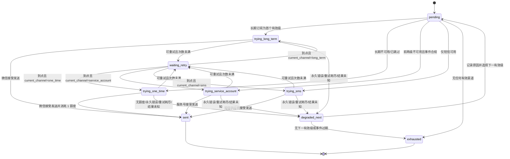
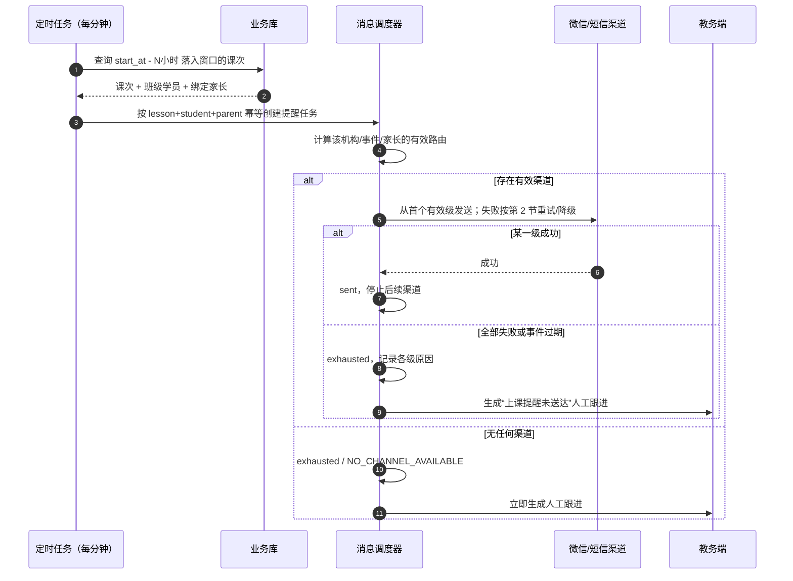
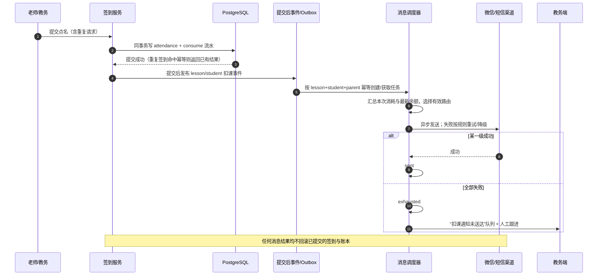
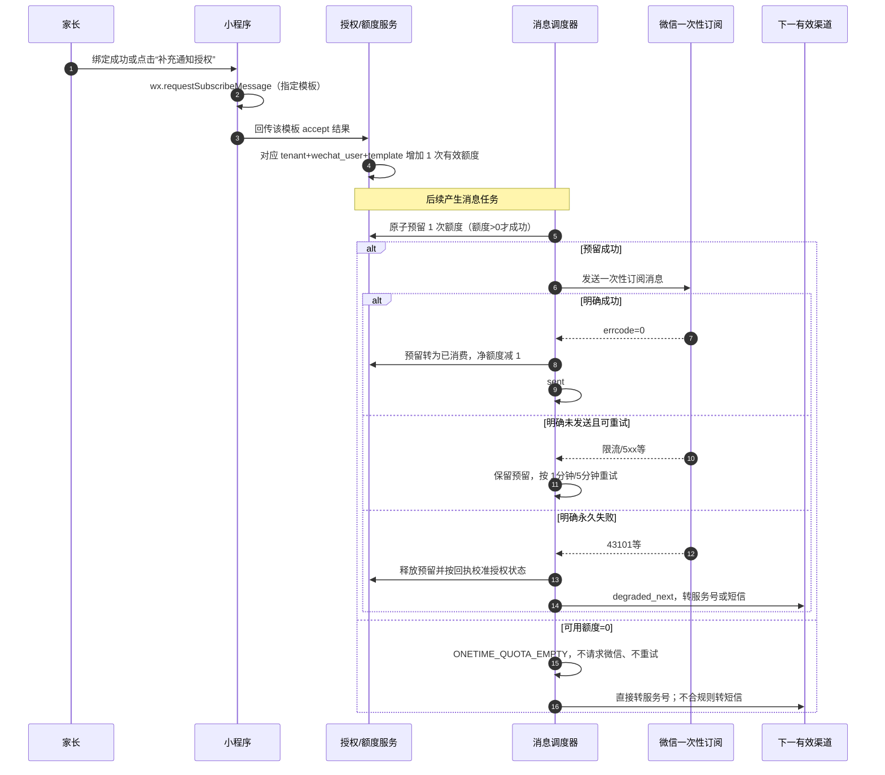
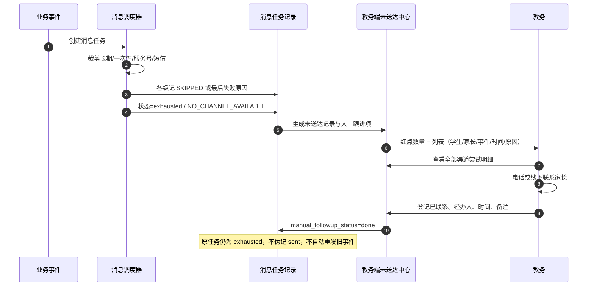

# 0.7 消息降级链设计（时序图 + 状态机）

> 对应《学生信息管理系统_分步执行清单》步骤 0.7。
> 消息推送全部为二期；本文只定设计，不写代码、不新增表结构。
> 上游：0.6 决策 5 的 `subscribe_auth` 占位图与微信身份映射。
> 逻辑链路：**长期订阅 → 一次性订阅 → 服务号模板消息 → 短信 → 教务人工跟进**。实际执行按平台能力、机构配置、事件合规性与家长授权动态裁剪。

## 1. 微信平台约束与项目可用口径（先查证，后设计）

### 1.1 长期订阅不是教育培训小程序的默认能力

微信官方规则（2026-10-30 查证）：

- 长期性订阅消息仅向**政务民生、医疗、交通、金融、教育等线下公共服务的部分类目/场景**开放；“教育”不等于所有教育二级类目都可用。
- 是否具有某场景能力，以小程序管理后台「功能 → 订阅消息 → 公共模板库」中**实际可选的长期订阅模板**为准；模板库没有对应模板，就按不支持处理。
- 一次性订阅是用户授权后，可不限时间地下发**一条**对应服务消息；一次授权不等于长期发送权限，用户退订/关闭通知还可能清空既有次数。

**本项目的真实口径**：当前尚未提供平台统一小程序的 appid、主体资质、已审核类目和后台模板清单，因此不能宣称已经获得“教育 > 培训机构”或其他长期订阅类目。设计默认其**长期订阅可用集合为空集**，上线前以平台 appid 后台实际上课提醒、课时消耗模板为验收依据；未核验前主路径从一次性订阅开始。

统一小程序还有一个不能混淆的边界：**长期订阅能力取决于平台 appid 自己的主体、类目与模板，不取决于某个租户机构的办学资质**。不能用 A 机构的办学许可证给平台统一小程序开通能力，也不能假设不同机构在同一 appid 下拥有不同的小程序类目。

上线前的能力核验清单：

1. 记录平台 appid、主体、已审核一级/二级类目与资质有效期；
2. 分别核验“上课提醒”“课时消耗/学员考勤”是否有可用的长期订阅模板及 template_id；
3. 核验同一事件的一次性订阅模板，作为默认主路径；
4. 能力变化只更新平台能力配置，不改降级状态机。

### 1.2 服务号与短信也不是无条件可用

- **服务号模板消息**：要求机构已授权认证服务号、家长已关注、存在该服务号 appid 下的 openid 映射，并选用与行业和服务场景相符的模板。微信运营规范要求消息基于实际服务交互且用户有接收预期；不能把服务号当成任意上课提醒的群发通道。`deduct_notice` 属于签到/课时消耗后的服务结果通知，适配性较高；`lesson_reminder` 只有在家长已主动订阅、模板与场景审核允许时才启用，否则直接跳过该级。
- **短信**：机构已配置短信服务商、家长有可用手机号且具备必要告知/同意时才启用；无手机号、退订、供应商未配置均直接跳过。短信只发必要服务通知，不带营销内容。

参考官方文档见第 8 节。

### 1.3 链路按实际能力动态裁剪

每个消息任务按“**平台 appid 能力 + 租户配置 + 事件类型 + 家长当前渠道状态**”计算有效路由；不可用等级记为 `SKIPPED`，不计失败次数、不空调微信接口。

| 实际条件 | 有效链路 |
|----------|----------|
| 默认：无长期订阅，无机构服务号，已配短信 | 一次性订阅 → 短信 → 人工 |
| 长期订阅可用，服务号与短信均可用，且事件合规 | 长期订阅 → 一次性订阅 → 服务号 → 短信 → 人工 |
| 长期不可用，服务号可用且事件合规 | 一次性订阅 → 服务号 → 短信 → 人工 |
| 服务号有配置，但上课提醒不符合其模板场景 | 一次性订阅 → 短信 → 人工（服务号仅对该事件跳过） |
| 一次性额度为 0 | 不请求微信，直接从下一有效级开始 |
| 家长所有渠道均不可用 | 直接进入 `exhausted`，生成教务人工跟进项 |

路由在任务创建时计算一次，并在每次降级时重新校验；授权、关注、手机号或机构配置变化后，下一级使用最新状态。

---

## 2. 每级失败语义、重试与最终兜底

### 2.1 通用约定

- “最多重试 2 次”指**首次尝试之外再试 2 次**，单级最多 3 次请求；间隔指第 1/2 次重试前的等待时间。
- 仅网络连接失败、明确可重试的上游 5xx、限流/并发类错误进入重试；权限、模板、参数、未订阅、未关注、无额度、无手机号等永久性错误**不重试，立即降级**。
- 请求已经发出但超时、无法确认上游是否接收时记 `TIMEOUT_UNKNOWN`：**不盲目重试同一渠道**，直接降级并保留“可能已送达”标记，防止重复通知。
- 每级均设置请求超时 5 秒；重试由 `next_attempt_at` 调度，不由 worker 睡眠占用连接。
- 上课提醒在课次开始后不再发送；扣课通知超过 24 小时不再自动发送。到期记 `EVENT_EXPIRED`，进入 `exhausted` 并转人工核对，而不是补发过时的自动消息。
- `sent` 只表示渠道服务已接受/返回成功，不冒充“家长已读”。后续若供应商提供明确送达回执，可另外记录 delivered 状态，但不改变本状态机。

### 2.2 四级链路验收表

| 级别 | 进入条件 | 失败后的下一步 | 重试次数与间隔 | 本级最终兜底 |
|------|----------|----------------|----------------|--------------|
| 1. 长期订阅 | 平台 appid 有匹配长期模板；家长授权有效；事件适用 | 永久错误立即转一次性订阅；可重试错误达到上限后也转一次性订阅 | 最多 2 次；1 分钟、5 分钟 | 一次性订阅；若其不可用则继续动态裁剪，最终人工 |
| 2. 一次性订阅 | 对应 tenant + 家长 + 模板有可用额度 | 额度不足/用户未订阅直接转服务号；其他永久错误同样转服务号 | 最多 2 次；1 分钟、5 分钟；**无额度不重试** | 服务号模板消息；服务号不适用则短信，最终人工 |
| 3. 服务号模板消息 | 机构已授权、家长已关注、有对应 openid、模板与事件合规 | 永久错误或服务号场景禁用转短信；可重试错误达到上限后转短信 | 最多 2 次；5 分钟、15 分钟 | 短信；短信不可用则人工 |
| 4. 短信 | 机构已配置供应商；家长手机号可用且允许服务通知 | 永久错误不再重试；可重试错误达到上限后终止自动链路 | 最多 2 次；5 分钟、15 分钟 | 状态置 `exhausted`，立即生成教务人工跟进项 |

“转下一级”始终指**下一个有效级**，不是机械地四级全走。例：长期订阅不可用时，任务创建即进入一次性订阅，不先制造一次无意义的长期订阅失败。

### 2.3 统一失败原因码

| 原因码 | 适用级别 | 语义与动作 |
|--------|----------|------------|
| `CHANNEL_NOT_CONFIGURED` | 全部 | 机构/平台未配置，跳过，不重试 |
| `TEMPLATE_UNAVAILABLE` | 长期/一次性/服务号 | 无匹配模板或模板失效，降级并告警配置管理员 |
| `SCENARIO_NOT_ALLOWED` | 服务号 | 事件不符合模板运营场景，跳过该级 |
| `USER_NOT_SUBSCRIBED` | 长期 | 无长期授权或已退订，降级 |
| `ONETIME_QUOTA_EMPTY` | 一次性 | 本地额度为 0，不请求微信，降级 |
| `WX_43101_NO_SUBSCRIPTION` | 长期/一次性 | 微信返回未订阅/次数已用完；同步本地授权状态后降级 |
| `WX_40003_INVALID_OPENID` | 微信渠道 | openid 与 appid 不匹配或无效，降级并标记映射异常 |
| `WX_40037_INVALID_TEMPLATE` | 微信渠道 | template_id 无效，降级并告警配置管理员 |
| `WX_47003_INVALID_PARAM` | 微信渠道 | 模板参数不合法，降级并触发开发/配置告警，不做无意义重试 |
| `WX_43107_CAPABILITY_BLOCKED` | 微信渠道 | 账号或模板能力封禁，停用对应能力并降级 |
| `WX_43108_CONCURRENT_SEND` | 微信渠道 | 同一用户并发下发，按可重试错误处理 |
| `NOT_FOLLOWING_SERVICE_ACCOUNT` | 服务号 | 家长未关注或已取关，降级 |
| `SERVICE_ACCOUNT_UNAUTHORIZED` | 服务号 | 机构授权失效，降级并通知管理员重新授权 |
| `SMS_NO_VERIFIED_PHONE` | 短信 | 无可用手机号，跳过 |
| `SMS_USER_OPTED_OUT` | 短信 | 家长已退订，停止短信并降级到人工 |
| `SMS_PROVIDER_REJECTED` | 短信 | 供应商明确拒收，按永久错误处理 |
| `RATE_LIMITED` / `UPSTREAM_5XX` / `NETWORK_ERROR` | 全部 | 可重试错误，按间隔重试 |
| `TIMEOUT_UNKNOWN` | 全部 | 结果不确定，不重复同渠道请求，降级并标记可能已送达 |
| `EVENT_EXPIRED` | 全部 | 事件已过自动发送期限，转 `exhausted` |
| `NO_CHANNEL_AVAILABLE` | 全部 | 所有渠道均不可用，直接进入 `exhausted` 并转人工 |

每次尝试保留：渠道、第几次、开始/结束时间、原因码、上游 errcode/errmsg/rid（如有）、下一次重试时间；敏感内容按最小必要记录，不记完整手机号。

---

## 3. 消息任务状态机

消息任务只对应未来的 `message_task` 概念；**本步不留表结构**。逻辑上至少需要事件幂等键、租户、接收家长、学生、事件类型、当前状态/渠道、尝试次数、下次重试时间、最后错误、过期时间和人工跟进状态。

- `degraded_next` 是**可持久化的过渡状态**，用于审计“哪一级为何失败、准备降到哪级”，不是任务终态。
- `sent`、`exhausted` 是终态；进入终态后 worker 不再自动发送同一事件。
- `exhausted` 表示“自动渠道未送达”。人工电话联系完成后只更新 `manual_followup_status=done`、经办人和备注，**不把原消息任务伪改成 sent**。

---

## 4. 场景一：上课提醒（课前 N 小时，N 可配置）

机构级配置 `lesson_reminder_hours`，默认 2 小时；定时任务每分钟扫描 `start_at - N小时` 落在当前窗口的有效课次（已取消课次不进入扫描），为每个在读学生、每个已绑定家长各建一个逻辑消息任务。调课后沿用同一 lesson_id 时更新未发送任务的内容，不重复创建任务；已经发送的提醒不自动重发，课次变更通知属于另一事件类型。

同一孩子有多名家长时分别生成任务；一名家长送达成功不代表另一名家长已送达。

---

## 5. 场景二：扣课通知（签到事务提交后触发）

扣课通知绝不在签到数据库事务内调用外部渠道。签到与扣课流水提交成功后，才发布领域事件并异步发送；消息失败不能回滚签到，也不能阻塞老师继续点名。

一名学生一次课次即使按 0.4 规则拆成多条 consume 流水，也只生成一条扣课通知，内容汇总总扣课时；重复签到产生相同幂等键，不再生成第二条通知。

---

## 6. 场景三：一次性订阅额度管理

### 6.1 何时引导授权

- 家长首次成功绑定孩子后，在结果页由家长点击“接收上课/扣课通知”，分别授权对应模板；
- 家长查看课表、余额或明细时，若某模板可用额度低于 2 次，展示一次性授权入口；必须由家长点击触发，不能在页面加载时自动反复弹窗；
- 授权入口只增加对应 `tenant_id + wechat_user_id + template_id` 的额度，不允许客户端指定其他家长或租户；
- 家长拒绝后本次不再纠缠，消息任务按现有额度与后续渠道正常降级。

### 6.2 额度计算与扣减

逻辑额度 = **累计有效授权次数 − 已成功发送次数 − 进行中预留次数**。授权和发送不能只看 `subscribe_auth.status=authorized`；阶段 1 落地数据模型时需能表达授权次数/授权事件，本步不新增表结构。

明确未发送的可重试错误在重试耗尽后也释放预留；只有 `TIMEOUT_UNKNOWN` 时预留不得释放给其他任务，标记结果未知并降级。这样既不超用授权，也避免把可能已消耗的额度再次分配。授权次数按租户和模板隔离，A 机构授权不能被 B 机构任务消耗。

---

## 7. 场景四：家长完全无触达渠道

“完全无渠道”包括：长期订阅不可用或未授权、一次性额度为 0、服务号未配置/未关注/事件不合规、短信未配置/无手机号/已退订。跳过所有无效级后，终态必须是 `exhausted`，不能停在 pending 或无限重试。

教务端要求：

- 提供“未送达”独立入口与总数红点，可按机构内学生、事件类型、状态、时间筛选；
- 详情展示通知内容摘要、各级尝试/跳过原因、最后错误与人工跟进状态；
- 上课提醒失败后立即进入高优先级队列，目标 15 分钟内人工联系；扣课通知进入普通队列，目标 24 小时内核对；
- 人工完成只关闭跟进项，不删除失败历史；同一事件不重新入队，新的业务事件才生成新任务。

---

## 8. 幂等、并发与一致性规则

### 8.1 同一事件不重复发

统一事件幂等键（每个接收家长独立）：

- 上课提醒：`lesson_reminder:{tenant_id}:{lesson_id}:{student_id}:{wechat_user_id}`
- 扣课通知：`deduct_notice:{tenant_id}:{lesson_id}:{student_id}:{wechat_user_id}`

未来实现对 event_key 建唯一约束，创建使用 `INSERT ... ON CONFLICT DO NOTHING`；worker 通过行锁/租约保证同一任务同一时刻只有一个发送者。任一渠道进入 `sent` 后，其他重试和降级 worker 必须退出。

### 8.2 业务事件与消息的一致性

- 上课提醒扫描重复执行只得到同一 event_key；调课只更新未发送任务内容，已成功任务不重复发。
- 扣课事件在签到事务**提交后**发布；可采用事务型 Outbox 保证“提交成功必有事件”，但其表结构与消息任务表一样留到后续数据模型步骤。
- 一次性额度预占、成功消费、失败释放必须原子化；同一授权不能被两个任务同时预留。
- 外部微信/短信接口不提供本系统级别的端到端 exactly-once 保证，因此本设计的幂等边界是：**同一业务事件只存在一个有效任务、明确成功后不再发、未知结果不盲目重发**。不虚假承诺家长端绝对不可能重复。

## 9. 官方依据与完成自检

官方依据（2026-10-30 查证）：

1. [微信小程序订阅消息：消息分类、一次性/长期订阅规则](https://developers.weixin.qq.com/miniprogram/dev/framework/open-ability/subscribe-message-overview.html)
2. [微信开放文档：发送订阅消息及错误码](https://developers.weixin.qq.com/miniprogram/dev/server/API/mp-message-management/subscribe-message/api_sendmessage.html)
3. [服务号模板消息运营规范：实际交互、接收预期与场景限制](https://developers.weixin.qq.com/doc/service/guide/product/template_message/Template_Message_Operation_Specifications.html)

自检：

- [x] 四级链路均明确失败下一步、重试次数/间隔与最终人工兜底。
- [x] 长期订阅类目限制单独说明；未虚构平台 appid 已获能力，默认从一次性订阅开始。
- [x] 路由按平台能力、机构配置、事件合规和家长渠道动态裁剪，允许第一级为空。
- [x] 上课提醒、扣课通知、一次性额度、完全无渠道四个场景均有时序图。
- [x] 状态机含 pending、各级尝试、重试、degraded_next、sent、exhausted 与失败原因码。
- [x] 同一事件幂等、一次性额度原子扣减、提交后触发和未知结果防重均已明确。
